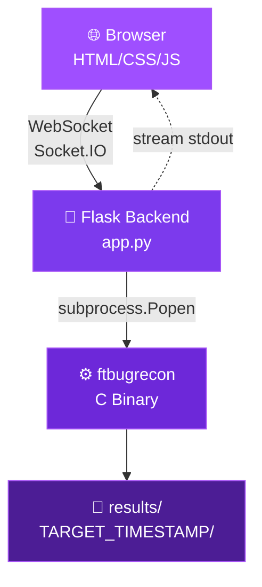

<div align="center">


<br/>

<a href="https://github.com/BLOODRAVENIST/FTWEB_X">
  
</a>

<br/>

<a href="https://github.com/BLOODRAVENIST/FTWEB_X">
  
</a>
<a href="https://github.com/BLOODRAVENIST/FTWEB_X/network/members">
  
</a>
<a href="https://github.com/BLOODRAVENIST/FTWEB_X/blob/main/LICENSE">
  
</a>
<a href="https://github.com/BLOODRAVENIST/FTWEB_X">
  
</a>
<a href="https://github.com/BLOODRAVENIST/FTWEB_X">
  
</a>

<br/><br/>

<a href="https://github.com/BLOODRAVENIST/FTWEB_X">
  
</a>
<a href="https://buymeacoffee.com/bloodravenist">
  
</a>
<a href="https://github.com/BLOODRAVENIST/FTBUGRECON">
  
</a>

<br/><br/>


</div>

<br/>

<div align="center">

## 🎯 What Is FTWEB_X?

</div>

<table align="center">
<tr>
<td width="50%" valign="top">

### 💀 The Problem

- ❌ Terminal-only recon tools
- ❌ Ugly CLI output
- ❌ No live feedback
- ❌ Hard to run parallel scans
- ❌ Copy-paste chaos

</td>
<td width="50%" valign="top">

### ⚡ The Solution

- ✅ **Beautiful browser UI**
- ✅ **Real-time streaming**
- ✅ **Matrix rain aesthetic**
- ✅ **One-click scan control**
- ✅ **Zero terminal needed**

</td>
</tr>
</table>

<div align="center">

**FTWEB_X** is a **browser-based GUI** that wraps [FTBUGRECON](https://github.com/BLOODRAVENIST/FTBUGRECON) — the 500+ tool bug bounty recon framework — in a **Flask + Socket.IO** server and streams every line of output live to an **animated purple hacker interface**.

<br/>

> *"Recon shouldn't feel like reading logs. It should feel like watching a movie."*

</div>

<br/>

<div align="center">


## ✨ Features That Hit Different

</div>

<table align="center">
<tr>
<td align="center" width="25%">

### ⚡
### Live Stream
WebSocket-powered real-time output. Every tool result appears **instantly** as it happens.

</td>
<td align="center" width="25%">

### 🌧️
### Matrix Rain
Animated purple falling characters. **Full hacker aesthetic**, zero compromise.

</td>
<td align="center" width="25%">

### 🎨
### Purple Theme
Deep violet gradients, pulse effects, fade-in animations. **FTBUGRECON matched**.

</td>
<td align="center" width="25%">

### 📱
### Responsive
Desktop. Tablet. Mobile. **Looks perfect everywhere**.

</td>
</tr>
<tr>
<td align="center">

### ▶️
### Start / Stop / Clear
Full control over scan lifecycle. **One-click everything**.

</td>
<td align="center">

### 📊
### Live Stats
Status, target, line count, elapsed timer — **updating in real-time**.

</td>
<td align="center">

### 🌐
### Auto-Open Browser
`./run.sh` starts the server and **opens your browser automatically**.

</td>
<td align="center">

### 🛡️
### Binary Detection
Missing `ftbugrecon`? **Warns you before the scan starts**.

</td>
</tr>
</table>

<br/>

<div align="center">


## 🏗️ Architecture

</div>



<br/>

<div align="center">


## 🚀 Quick Start

</div>

<table align="center">
<tr>
<td width="50%">

### 📦 Step 1 — Clone

```bash
git clone https://github.com/BLOODRAVENIST/FTWEB_X.git
cd FTWEB_X
```

</td>
<td width="50%">

### 🔧 Step 2 — Build Engine

```bash
cd ~/PROJECT/FTBUGRECON
make
```

</td>
</tr>
<tr>
<td width="50%">

### 🐍 Step 3 — Setup Python

```bash
cd ~/PROJECT/FTWEB_X
python3 -m venv venv
source venv/bin/activate
pip install -r backend/requirements.txt
```

</td>
<td width="50%">

### 🚀 Step 4 — Launch

```bash
chmod +x run.sh
./run.sh
```

**Browser opens automatically at**  
`http://127.0.0.1:5000`

</td>
</tr>
</table>

<br/>

<div align="center">


## 🎮 How To Use

</div>

```text
┌─────────────────────────────────────────────────┐
│  1. Server chalao   →   ./run.sh                │
│  2. Browser khulega →   http://127.0.0.1:5000   │
│  3. Target daalo    →   example.com             │
│  4. START SCAN      →   🟣 Click                │
│  5. Live output     →   Matrix rain background  │
│  6. STOP / CLEAR    →   Full control            │
└─────────────────────────────────────────────────┘
```

<br/>

<div align="center">


## 📁 File Structure

</div>

```bash
FTWEB_X/
│
├── 🐍 backend/
│   ├── app.py                  # Flask + Socket.IO server
│   └── requirements.txt        # Python dependencies
│
├── 🎨 templates/
│   └── index.html              # Main UI
│
├── 💅 static/
│   ├── style.css               # Animated purple theme
│   └── app.js                  # Matrix rain + Socket.IO client
│
├── 🚀 run.sh                   # Startup script
├── 🚫 .gitignore
├── ⚖️  LICENSE                  # MIT
└── 📖 README.md
```

<br/>

<div align="center">


## 🔌 API & WebSocket

</div>

<table align="center">
<tr>
<td width="50%" valign="top">

### 🌐 REST Endpoints

| Method | Endpoint | Purpose |
|:---:|---|---|
| `GET` | `/` | Main UI |
| `GET` | `/api/check` | Binary exists? |
| `POST` | `/api/start` | Start scan |
| `POST` | `/api/stop` | Stop scan |
| `GET` | `/api/status` | Scan status |

**Start payload:**
```json
{"target": "example.com"}
```

</td>
<td width="50%" valign="top">

### 📡 WebSocket Events

| Event | Direction | Purpose |
|:---:|---|---|
| `connect` | S → C | Connection ready |
| `scan_output` | S → C | Live output line |
| `scan_complete` | S → C | Finished + exit code |

**Client connect:**
```js
const socket = io();
socket.on('scan_output', line => {
  terminal.innerHTML += line + '<br/>';
});
```

</td>
</tr>
</table>

<br/>

<div align="center">


## 🛠️ Troubleshooting

</div>

<table align="center">
<tr>
<td width="50%">

| ❌ Issue | ✅ Fix |
|---|---|
| `Invalid async_mode` | `sed -i 's/threadlet/threading/' backend/app.py` |
| `Port 5000 in use` | `sudo lsof -i :5000` then `kill PID` |
| `ftbugrecon not found` | `cd ~/PROJECT/FTBUGRECON && make` |

</td>
<td width="50%">

| ❌ Issue | ✅ Fix |
|---|---|
| `ModuleNotFoundError` | `source venv/bin/activate && pip install -r backend/requirements.txt` |
| Browser not opening | Manually open `http://127.0.0.1:5000` |
| Permissions denied | `chmod +x run.sh` |

</td>
</tr>
</table>

<br/>

<div align="center">


## ⚖️ Legal Disclaimer

</div>

<div align="center">

> **🚨 FOR AUTHORIZED BUG BOUNTY & PENETRATION TESTING ONLY 🚨**

</div>

<table align="center">
<tr>
<td width="50%" valign="top">

### ✅ Allowed

- Targets within **valid bug bounty scope**
- **Authorized** penetration testing with **written permission**
- Lab environments (**HTB**, **THM**, **VulnHub**)
- **Your own** systems

</td>
<td width="50%" valign="top">

### ❌ Not Allowed

- Systems you **do not own**
- Systems you have **no permission** for
- **Unauthorized** access — illegal everywhere
- **Production** systems without scope

</td>
</tr>
</table>

<div align="center">

Unauthorized access is illegal under **CFAA (US)**, **Computer Misuse Act (UK)**, **IT Act (India)**, and similar laws worldwide.

**You are responsible for your own actions. Use responsibly.**

</div>

<br/>

<div align="center">


## 💜 Support The Project

</div>

<div align="center">

If **FTWEB_X** helped you land a bug, save time, or just look cool doing recon — **consider buying me a coffee**. ☕

<br/><br/>

<a href="https://buymeacoffee.com/bloodravenist">
  
</a>

<br/><br/>

### ⭐ Star this repo if it helped you ⭐

<br/>

<a href="https://github.com/BLOODRAVENIST/FTWEB_X">
  
</a>

</div>

<br/>

<div align="center">


<br/>


<br/>

<a href="https://github.com/BLOODRAVENIST">
  
</a>
<a href="https://github.com/BLOODRAVENIST/FTBUGRECON">
  
</a>

<br/><br/>


</div>
